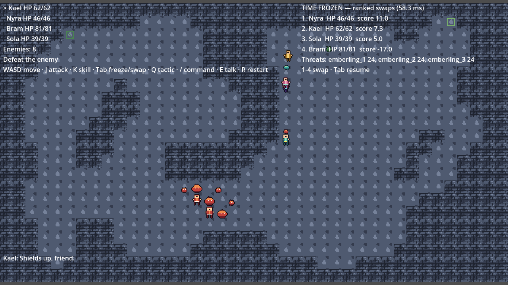

# AssetFabric

> **Private & proprietary** — © 2026 Recharged Ideas. All Rights Reserved. See [LICENSE](LICENSE).

**AssetFabric** is a universal content fabric and execution substrate for producing games and assets end-to-end: generation, validation, packaging, AI runtime, sandboxed execution, reconstruction, clustering, and companion tooling.

**Game Zero** — an offline-first 8-bit fighter/farming hybrid on Godot 4 — is its **first product and MVP test**. Every Fabric milestone is proven by a playable Game Zero increment.

**Not this product:** [Future Beasts](https://github.com/RechargedIdeas/future-beasts) is a separate browser game with its own HMAP engine. It does not import this studio. Game Zero is not Future Beasts.

**Architecture in one line:** Python/PySide6 **Studio** → **Content Forge** (generators · validators · orchestrator · BudgetGate) → **Substrate** (sandbox · hot reload · snapshots) → **Godot 4 Compatibility runtime** (GIRT · CascadeHub) — spread over equal **LoomCluster** nodes with **GroundWeave** CPU fallbacks, and a standalone Android companion, **PocketLoom**.

## Status

| | |
|---|---|
| Fabric milestone | **F7 — Packaging: Desktop / Android / Web PWA launch candidates, ShuttleLine multi, BoltPack** ✅ accepted (`forge accept F7`) |
| Game increment | `launch-candidates` — unsigned Linux + Windows builds, debug Android APK, Web PWA (9.3 MB gzip, offline) of the vertical slice; saves round-trip desktop → Android → Web → desktop |
| Companion track | **PocketLoom C1–C6** ✅ accepted (`forge accept C1-C6`) — standalone offline Android companion, debug APK ≈ 0.89 MB: on-device generation, library, capture, LoomLink pairing (code / QR URI / Tailscale), offload + sync. Not yet run on a phone (no device/KVM) |
| Fleet track | **LoomCluster C7 + GroundWeave C8** ✅ accepted (`forge accept C7-C8`) — equal nodes that advertise/negotiate, steal work, retry and recover from crashes (proven on **loopback processes**, not a LAN); results are byte-identical on 1, 2 or 3 nodes; every generator has a declared GPU→CPU ladder, and its CPU path is proven on 2 pinned cores with GPUs hidden. PocketLoom offloads run on the fleet via LoomLink. No real GPU backend exists yet — every GPU rung is a labelled `planned` stub |
| Companion interfaces | **C9 MirrorWeave · C10 LensForge · C11 depth · C12 SplatForge path** ✅ accepted as *typed interfaces + labelled stubs* (`forge accept C9-C12`) — 16 real CPU paths (stills/telemetry stream over LoomLink, integer-exact capture quality, pinhole depth + scale alignment, RealityLoom routing/bundle/plan, `.ply` validator), 14 stubs that refuse, 3 deferred. *Since the stub-replacement sprint (0.7.4–0.7.6): C9 live desktop video, C10 video + ARCore pose coverage, C11 dense depth (DepthAnything V2 Small, CPU) + ARCore depth ingest are real; phone halves are compiled as `real_unverified_on_device`. 0.7.7: C12 CPU photogrammetry (OpenCV SfM), MeshWeaver and GDGS Godot import are real; only SplatForge GPU training is stubbed; nothing ran on a phone or GPU* |
| Version | `0.7.3+f7` (PocketLoom `0.1.0-c6`) |
| Next | F8 retro/console-style is optional per the spec — **confirm scope with the Producer first**; F9 is post/LiveOps readiness only. Non-spec follow-ups: first real GPU rung, on-device PocketLoom run, LAN cluster + node auth (see [TODO.md](TODO.md)) |

Live dashboard: [STATUS.md](STATUS.md) · details: [HANDOVER.md](HANDOVER.md).



## Quick start

Requires Python ≥ 3.11 and [`uv`](https://docs.astral.sh/uv/). Godot 4.3+ is optional (needed for the full headless boot).

```bash
git clone https://github.com/RechargedIdeas/assetfabric.git
cd assetfabric
./scripts/bootstrap.sh
source .venv/bin/activate
forge doctor          # environment checks
forge status          # exit 0 == healthy
pytest -q
./scripts/smoke_godot.sh
forge build           # regenerate content from content/briefs/ (deterministic)
forge accept F6       # headless Godot acceptance (needs Godot 4.3); FORGE_ACCEPT_FAST=1 for the CI subset
forge build --target all   # F7 platform builds → dist/ (needs `forge templates fetch`, JDK 17, Android SDK; see docs/packaging.md)
forge accept C1-C6    # PocketLoom: Gradle build + debug APK verify + Kotlin↔Python LoomLink interop (JDK 17, Android SDK)
forge accept C7-C8    # LoomCluster loopback fleet + GroundWeave 2-core/no-GPU proofs (≈ 80 s; Godot for the runtime probes)
forge accept C9-C12   # MirrorWeave / LensForge / depth / SplatForge-path contracts + labelled stubs (JDK 17, Android SDK; ≈ 1 min warm)
forge mirror|lens|depth|recon --help   # C9–C12 hooks; stubs exit 3 with a [STUB …] label
forge cluster demo    # 3 local nodes, work stealing + SIGKILL failover   ·   forge groundweave show|check|verify
forge link serve --bind <LAN/Tailscale IP> [--cluster <node URL>]   # pair a PocketLoom phone (code + loomlink:// QR); offloads run on the fleet
forge balance run     # Monte Carlo G-BAL-01 matrix (12 matchups × 200 seeds)
forge live serve --headless &   # Game Zero under the guardian; then: forge live set sim.leash=72
```

Play Game Zero: `godot --path games/game-zero -- --scene=slice` (the vertical slice), or open `games/game-zero/` in the Godot editor. More: [docs/setup/README.md](docs/setup/README.md).

## Repository layout

| Path | Contents |
|---|---|
| `forge/` | Content Forge Python package and `forge` CLI |
| `forge.yaml` | Project manifest (milestone, targets, profiles, fleet) |
| `content/` | Content briefs, roster, world (economy/loot/quests/music/areas) + PatternVault palettes (inputs to `forge build`) |
| `docs/design/` | **Authoritative design specs** imported from the design chat |
| `docs/adr/` | Architecture Decision Records |
| `docs/schemas/` | JSON Schemas (manifest, telemetry) |
| `docs/acceptance-tests/` | Milestone acceptance checklists |
| `games/game-zero/` | Game Zero Godot 4 project ([README](games/game-zero/README.md)) |
| `studio/` | Desktop Studio (PySide6) — stub |
| `companions/pocketloom/` | PocketLoom Android companion + FabricCore (Kotlin) — C1–C6 ([README](companions/pocketloom/README.md)) |
| `forge/loomcluster.py`, `forge/groundweave.py`, `content/groundweave/ladder.yaml` | LoomCluster (C7) equal-node scheduler + GroundWeave (C8) fallback ladder; `cluster/loomcluster/` holds its README |
| `forge/mirrorweave.py`, `lensforge.py`, `depth.py`, `realityloom.py`, `stubs.py`, `registry.py`, `content/companions/c9_c12.yaml` | C9–C12 interfaces, real CPU paths and the real/stub/deferred register (`companions/pocketloom/fabriccore` has the Kotlin side) |
| `store/` | Content-addressed asset store (blobs gitignored) |
| `locales/` | Locale string tables (no hard-coded strings) |
| `content/tune/` | Live-tune limits (F4); also bound balance/tuning knobs (F5) |
| `scripts/` | bootstrap and smoke scripts |
| `tests/` | pytest suite |

## Documentation map

| Doc | Role |
|---|---|
| [AGENTS.md](AGENTS.md) | Rules of engagement for agents and humans — **read first** |
| [HANDOVER.md](HANDOVER.md) | Current state snapshot |
| [TODO.md](TODO.md) | Sprint tasks, backlog, blockers, decisions needed |
| [PLAN.md](PLAN.md) | Vision, pillars, Definition of Done, out-of-scope |
| [BUILD_ORDER.md](BUILD_ORDER.md) | F0–F9 + C1–C12 sequence |
| [ARCHITECTURE.md](ARCHITECTURE.md) | Systems map and code map |
| [DECISIONS.md](DECISIONS.md) | ADR index |
| [TESTING.md](TESTING.md) | QA pyramid, acceptance, CI gates |
| [SECURITY.md](SECURITY.md) | Threat model, vulnerability reporting, confidentiality |
| [CONTRIBUTING.md](CONTRIBUTING.md) | Setup, workflow, PR checklist |
| [GLOSSARY.md](GLOSSARY.md) | Terms |
| [CHANGELOG.md](CHANGELOG.md) | Version history |
| [STATUS.md](STATUS.md) | Generated milestone dashboard |
| [docs/design/](docs/design/README.md) | ASSETFABRIC_SPEC, GAME_SPEC, ML/AI features, chat summary |
| [docs/tool-catalog.md](docs/tool-catalog.md) | Fabric tools and their milestones |
| [docs/SUBSTRATE.md](docs/SUBSTRATE.md) | Sandbox tiers, live channel, snapshots, statecharts, guardian (F4) |
| [docs/acceptance-tests/F5.md](docs/acceptance-tests/F5.md) | Balance runner, Optuna tuning, soft-lock detection, save migration, first boss (F5) |
| [docs/acceptance-tests/F6.md](docs/acceptance-tests/F6.md) | Vertical slice: quests, farming/craft, loot, adaptive music, cave ↔ open world, save/quit/reload (F6) |
| [docs/acceptance-tests/F7.md](docs/acceptance-tests/F7.md) | Launch candidates: Linux/Windows/Android/Web builds, G-WEB-01, G-SAVE-01, G-NET-01, sizes + SHA-256 (F7) |
| [docs/packaging.md](docs/packaging.md) | How to build, verify and host every platform build; signing/store TODO (F7) |
| [docs/hardware-fleet.md](docs/hardware-fleet.md) | AMD-first node inventory |
| [docs/INFERENCES.md](docs/INFERENCES.md) | Register of `[INFERENCE]` decisions |

Design source: https://chat.deepseek.com/share/g90tn4mss3265u0xm3 — prefer the specs over invention; extrapolations are marked **`[INFERENCE]`**.

## Governing principle

> A Fabric milestone is **not complete** until a **game increment that depends on it ships, is playable, and passes its acceptance test.** (ADR-0016)

## Hard constraints

No LLM in the combat tick · no unsandboxed untrusted code · no client-authoritative multiplayer · no hard-coded strings/paths · every GPU path has a CPU fallback · weakest acceptance node is 2 cores, no GPU · AMD-first (DirectML/ROCm/Vulkan), never CUDA-required.

## v1 non-goals

Quantum hardware backends (simulation OK), fantasy consoles (PICO-8/TIC-80), modern console CertPacks, mod marketplace, P2P beyond 2 players, dedicated servers, M1-Architect as a ship gate.

## License & distribution

Proprietary — **All Rights Reserved** (ADR-0001). This repository is private; there are no public releases, packages, or open-source distributions. Third-party components keep their own licenses ([THIRD_PARTY_NOTICES.md](THIRD_PARTY_NOTICES.md)). Report security issues privately per [SECURITY.md](SECURITY.md).
