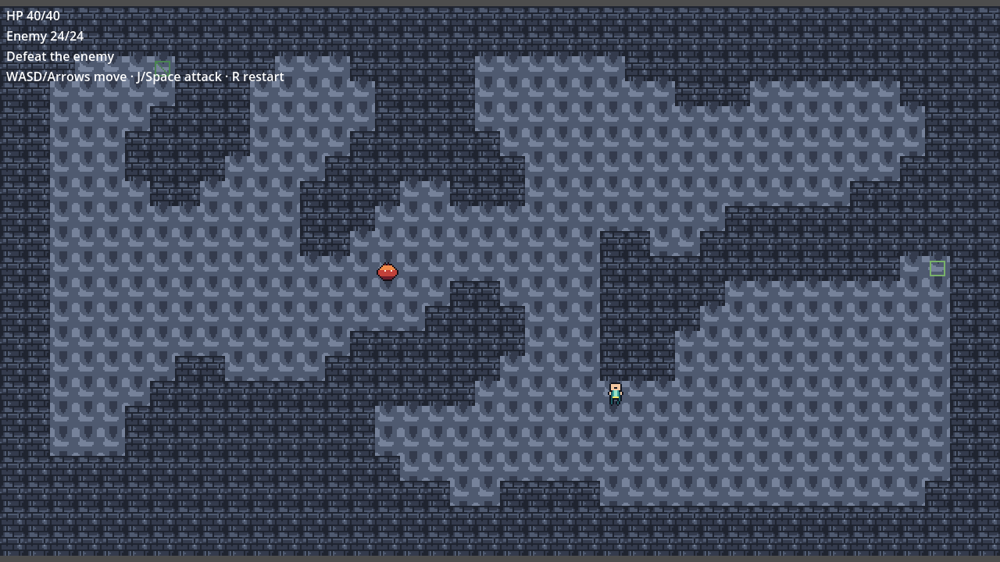

# AssetFabric

> **Private & proprietary** — © 2026 Recharged Ideas. All Rights Reserved. See [LICENSE](LICENSE).

**AssetFabric** is a universal content fabric and execution substrate for producing games and assets end-to-end: generation, validation, packaging, AI runtime, sandboxed execution, reconstruction, clustering, and companion tooling.

**Game Zero** — an offline-first 8-bit fighter/farming hybrid on Godot 4 — is its **first product and MVP test**. Every Fabric milestone is proven by a playable Game Zero increment.

**Architecture in one line:** Python/PySide6 **Studio** → **Content Forge** (generators · validators · orchestrator · BudgetGate) → **Substrate** (sandbox · hot reload · snapshots) → **Godot 4 Compatibility runtime** (GIRT · CascadeHub) — spread over equal **LoomCluster** nodes with **GroundWeave** CPU fallbacks, and a standalone Android companion, **PocketLoom**.

## Status

| | |
|---|---|
| Fabric milestone | **F1 — Content Pipeline** ✅ accepted (`forge accept F1`) |
| Game increment | `sandbox-encounter` — 1 character, 1 generated cave, 1 enemy, 1 attack; playable + headless-proven |
| Version | `0.1.0+f1` |
| Next | F2 Codegen + G1-Audio → first full combat (party of 4 + pets + enemies) |

Live dashboard: [STATUS.md](STATUS.md) · details: [HANDOVER.md](HANDOVER.md).



## Quick start

Requires Python ≥ 3.11 and [`uv`](https://docs.astral.sh/uv/). Godot 4.3+ is optional (needed for the full headless boot).

```bash
git clone https://github.com/RechargedIdeas/assetfabric.git
cd assetfabric
./scripts/bootstrap.sh
source .venv/bin/activate
forge doctor          # environment checks
forge status          # exit 0 == healthy
pytest -q
./scripts/smoke_godot.sh
forge build           # regenerate content from content/briefs/ (deterministic)
forge accept F1       # headless Godot acceptance (needs Godot 4.3)
```

Play Game Zero: `godot --path games/game-zero`, or open `games/game-zero/` in the Godot editor. More: [docs/setup/README.md](docs/setup/README.md).

## Repository layout

| Path | Contents |
|---|---|
| `forge/` | Content Forge Python package and `forge` CLI |
| `forge.yaml` | Project manifest (milestone, targets, profiles, fleet) |
| `content/` | Content briefs + PatternVault palettes (inputs to `forge build`) |
| `docs/design/` | **Authoritative design specs** imported from the design chat |
| `docs/adr/` | Architecture Decision Records |
| `docs/schemas/` | JSON Schemas (manifest, telemetry) |
| `docs/acceptance-tests/` | Milestone acceptance checklists |
| `games/game-zero/` | Game Zero Godot 4 project ([README](games/game-zero/README.md)) |
| `studio/` | Desktop Studio (PySide6) — stub |
| `companions/pocketloom/` | Android companion — placeholder |
| `cluster/loomcluster/` | Compute clustering — placeholder |
| `store/` | Content-addressed asset store (blobs gitignored) |
| `locales/` | Locale string tables (no hard-coded strings) |
| `scripts/` | bootstrap and smoke scripts |
| `tests/` | pytest suite |

## Documentation map

| Doc | Role |
|---|---|
| [AGENTS.md](AGENTS.md) | Rules of engagement for agents and humans — **read first** |
| [HANDOVER.md](HANDOVER.md) | Current state snapshot |
| [TODO.md](TODO.md) | Sprint tasks, backlog, blockers, decisions needed |
| [PLAN.md](PLAN.md) | Vision, pillars, Definition of Done, out-of-scope |
| [BUILD_ORDER.md](BUILD_ORDER.md) | F0–F9 + C1–C12 sequence |
| [ARCHITECTURE.md](ARCHITECTURE.md) | Systems map and code map |
| [DECISIONS.md](DECISIONS.md) | ADR index |
| [TESTING.md](TESTING.md) | QA pyramid, acceptance, CI gates |
| [SECURITY.md](SECURITY.md) | Threat model, vulnerability reporting, confidentiality |
| [CONTRIBUTING.md](CONTRIBUTING.md) | Setup, workflow, PR checklist |
| [GLOSSARY.md](GLOSSARY.md) | Terms |
| [CHANGELOG.md](CHANGELOG.md) | Version history |
| [STATUS.md](STATUS.md) | Generated milestone dashboard |
| [docs/design/](docs/design/README.md) | ASSETFABRIC_SPEC, GAME_SPEC, ML/AI features, chat summary |
| [docs/tool-catalog.md](docs/tool-catalog.md) | Fabric tools and their milestones |
| [docs/hardware-fleet.md](docs/hardware-fleet.md) | AMD-first node inventory |
| [docs/INFERENCES.md](docs/INFERENCES.md) | Register of `[INFERENCE]` decisions |

Design source: https://chat.deepseek.com/share/g90tn4mss3265u0xm3 — prefer the specs over invention; extrapolations are marked **`[INFERENCE]`**.

## Governing principle

> A Fabric milestone is **not complete** until a **game increment that depends on it ships, is playable, and passes its acceptance test.** (ADR-0016)

## Hard constraints

No LLM in the combat tick · no unsandboxed untrusted code · no client-authoritative multiplayer · no hard-coded strings/paths · every GPU path has a CPU fallback · weakest acceptance node is 2 cores, no GPU · AMD-first (DirectML/ROCm/Vulkan), never CUDA-required.

## v1 non-goals

Quantum hardware backends (simulation OK), fantasy consoles (PICO-8/TIC-80), modern console CertPacks, mod marketplace, P2P beyond 2 players, dedicated servers, M1-Architect as a ship gate.

## License & distribution

Proprietary — **All Rights Reserved** (ADR-0001). This repository is private; there are no public releases, packages, or open-source distributions. Third-party components keep their own licenses ([THIRD_PARTY_NOTICES.md](THIRD_PARTY_NOTICES.md)). Report security issues privately per [SECURITY.md](SECURITY.md).
